<div align="center">
  <picture>
    <source media="(prefers-color-scheme: dark)" srcset="./logo_dark.svg">
    <source media="(prefers-color-scheme: light)" srcset="./logo_light.svg">
    
  </picture>
</div>

<div align="center">

# Hi, I'm Gustavo 👋

**Java Backend · Android · Applied AI**

[LeetCode](https://leetcode.com/u/Chicolinguica/) · [Email](mailto:gustavocampeol28@gmail.com) · [Discord](https://discord.com/users/gustavo_.cl)

</div>

<!-- readme:start -->
```text
❯ Gustavo Campeol @Campeol-G
  Java Backend · Android · Applied AI
  ──────────────────────────────────────────────────────────────

  system
    os ................ Arch Linux, Windows 11, Android
    host .............. Computer science student — backend Java
    editor ............ VS Code, Neovim, Zed

  projects
    Study-Simplifier
    SiteBlock
    Nothing-Launcher

  stack
    languages ......... Java, Python, SQL
    frameworks ........ Spring Boot, Android
    databases ......... PostgreSQL, MongoDB, MySQL
    tools ............. Gradle, Maven, Docker, Kafka, Git

  activity
    Commits (12mo) .... 143
    Repos ............. 5
    Streak ............ 12 days
    Lines of Code ..... 7,217  ( +8,421 / -1,204 )
    working in ........ SuperJogoDaVelha

  about
    spoken ............ Portuguese (native) · English (conversational)
    into .............. Applied AI, distributed systems, Android, CLI & TUI
    uptime ............ 17 years, 4 months, 4 days

  contact
    email ............. gustavocampeol28@gmail.com
    leetcode .......... Chicolinguica
    discord ........... gustavo_.cl
```
<!-- readme:end -->

## Projects

<!-- projects:start -->
| Project | What it is |
|---|---|
| **[Study-Simplifier](https://github.com/Campeol-G/Study-Simplifier)** | AI study planner — LLM + RAG · Spring Boot + React |
| **[SiteBlock](https://github.com/Campeol-G/SiteBlock)** | Cross-platform CLI to block domains — hosts file + DNS |
| **[Nothing-Launcher](https://github.com/Campeol-G/Nothing-Launcher)** | Single-screen Android launcher — no icons, no widgets |
<!-- projects:end -->
